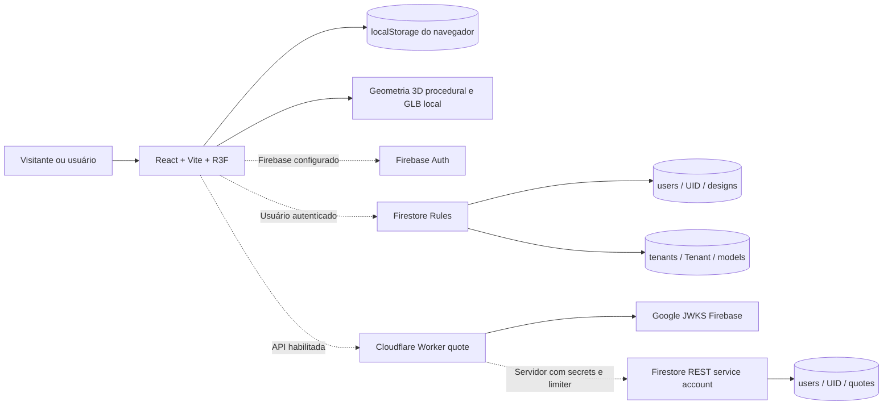
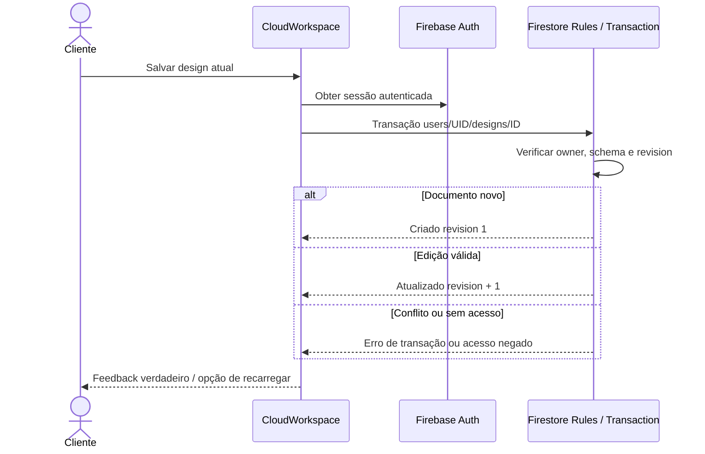
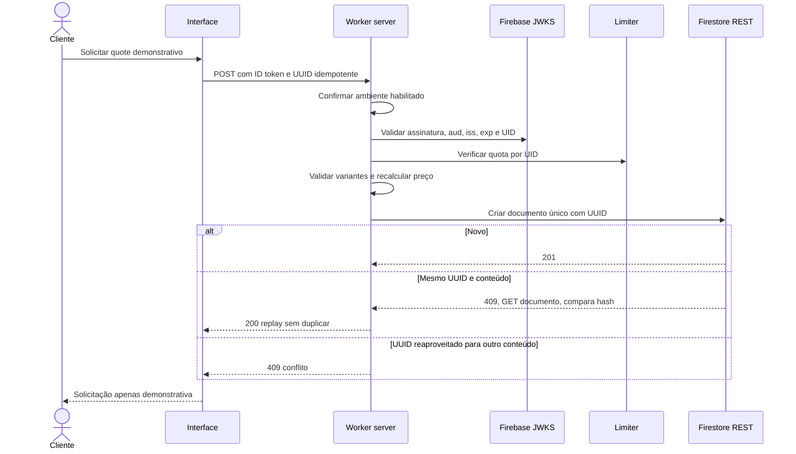
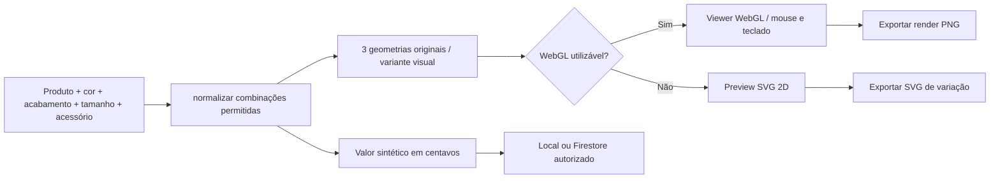

# RFB Studio — arquitetura implementada e alvo de implantação

**Data:** 23/11/2026. Diagramas Mermaid representam contratos de código e fronteiras de confiança. Setas tracejadas representam integrações **desligadas/não implantadas**, não evidências de produção.

## A-01 — Componentes e fronteiras

Estado: SPA, modelo, localStorage e UI testados em Chromium; Auth+Rules em Emulator; Worker quote mockado em Vitest; Cloudflare e Firebase reais NÃO implantados.

## A-02 — Design por usuário com revisão

## A-03 — Quote autenticado e idempotente (não implantado)

**Obs.:** JWKS/OAuth/limiter e Firestore REST **não foram validados juntos num Worker remoto**. Nenhum fornecedor recebe mensagem.

## A-04 — Papéis e dados
| Operação | Visitante | Cliente | Designer | Vendedor | Admin do tenant |
|---|---|---|---|---|---|
| Ver catálogo demo local | Sim | Sim | Sim | Sim | Sim |
| CRUD do próprio design | Não | Sim | Sim | Sim | Sim |
| Ler metadados não publicados do tenant | Não | Não | Sim | Sim | Sim |
| Criar/editar modelos do tenant | Não | Não | Próprios | Não | Sim |
| Excluir modelos do tenant | Não | Não | Próprios | Não | Sim |
| Escrever quote diretamente no Firestore | Não | Não | Não | Não | Não (API confiável) |
| Modificar preço comercial ou criar pedido real | Não implementado | Não implementado | Não implementado | Não implementado | Não implementado |

Papel/tenant devem vir de **custom claims assinadas pelo Firebase**, atribuídas fora do navegador por administrador de confiança. Nenhuma seleção na UI concede permissão.

## A-05 — Render e exportação

Modelos GLB externos passam por validação 8 MB, estrutura glTF2 e restrições a URLs externas; nunca são enviados, monetizados ou incluídos em quotes.

## Contratos operacionais
- `docs/PROGRESS.md` e `PROJECT_STATUS.json`: evidência real e não realizado.
- `docs/BACKEND-SECURITY.md`: threat model.
- `docs/DEPLOY-PLAN.md`: gates de rollout sem ativar serviços pagos.

## Atualização do fluxo (23/11/2026)
- O render 3D carrega sob demanda pelo React lazy, e a prévia SVG usa módulo independente; falha de chunk passa por Error Boundary e fallback sem falsificar renderização.
- O fluxo privado tem `GET`, `POST` e `DELETE` por UUID; a identidade é derivada do ID token verificado, nunca do corpo. Testes reais de armazenamento **somente no Firestore Emulator**.
- Recuperação de conflito é por criação de cópia, sem forçar overwrite. Export de nuvem é limitado intencionalmente, não backup integral.
- No caminho local, TXT e `mailto:` são alternativas de colaboração manual sem side effects automáticos, contrato ou envio.
